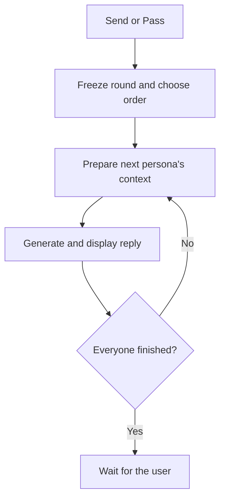
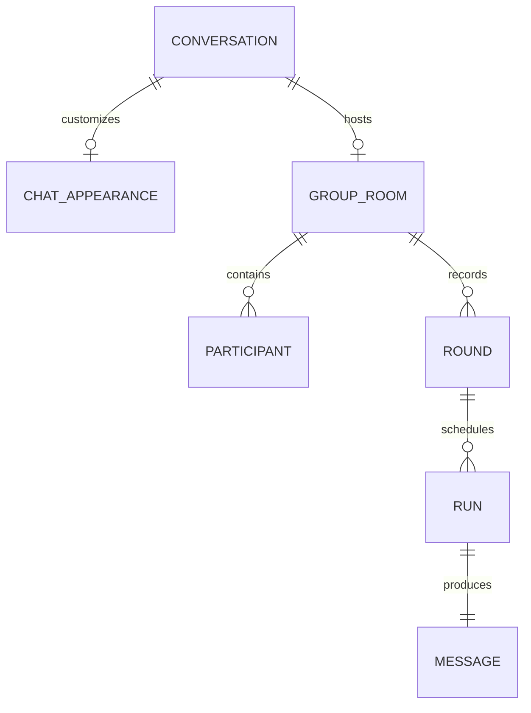

# Local persona chats, avatars, and Liquid model support

Build persona group chats for the **iPhone 17 Pro Max**, using one selected local model shared by all participants. Generate replies sequentially and keep the model loaded between replies.

## Assumptions

- Support **Qwen3.5 4B Q4_K_M** and **LFM2.5-2.6B Q4_K_M**. Qwen remains the reference/default; Liquid is selectable.
- Default to a 4,096-token context, 256-token replies, and reasoning disabled.
- Personas use their instructions and room history. Long-term memory retrieval and extraction are outside v1.
- Each automatic round gives everyone one turn, then waits for the user.

## Foundation

### Settings and controls

| Setting | Choices | Default |
|---|---|---|
| Conversation | Discussion / Independent answers | Discussion |
| Order | Round robin / Dice roll / Topic interest | Round robin |
| Reply display | Complete replies / Live text | Complete replies |
| Drunk | Per-persona toggle within this room | Off |
| Shared model | Qwen / Liquid | Qwen |
| Response limit | Adjustable | 256 tokens |

- **Discussion:** later speakers receive earlier completed replies.
- **Independent answers:** everyone receives the same starting transcript, with their own persona instructions.
- **Pass:** continue the discussion for one additional round without inserting a fabricated user message. Disable before a conversation starts.
- **Ask a persona:** generate one selected participant’s reply, using composer text when present or continuing the discussion otherwise.
- **Stop:** cancel the current generation and prevent later participants from starting.
- Prevent overlapping Send, Pass, and Ask actions.

### Implementation changes

1. **Extend existing group contracts and storage.** Add room settings, a shared local-model binding, stable participant IDs, and per-participant `drunk`. Persist each round’s trigger, frozen order, settings, and speaker runs. Use dedicated group conversations rather than the current solo conversation.

2. **Reuse one native model context.** Keep one generation slot and serialize persona and speaker-selection requests. Rebuild each request’s complete prompt so persona instructions cannot carry over accidentally. Release resources on backgrounding, leaving the room, model changes, or memory pressure.

3. **Add Liquid to the catalog.** Use the official `LiquidAI/LFM2.5-2.6B-GGUF` artifact `LFM2.5-2.6B-Q4_K_M.gguf`, approximately 1.67 GB. Pin its revision, checksum, size, and license metadata through the existing download flow. Apply publisher defaults through model presets: temperature `0.1`, `top_k: 50`, and repetition penalty `1.1`; map the latter to native `repeat_penalty`. Add the missing native parameter forwarding and capability declarations while preserving explicit user overrides. [Official GGUF repository](https://huggingface.co/LiquidAI/LFM2.5-2.6B-GGUF)

4. **Connect the turn controller.** Expose Send, Pass, Ask, and Stop actions. Freeze actual persona instructions and identity at round start. Add an assistant-only generation path to the durable chat engine, accepting prepared context and participant attribution. Save the user message once and create separate assistant messages and runs for participants.

5. **Implement order selection.** Round robin follows seating order. Dice roll produces a shuffled permutation saved with the round. Topic interest makes one short structured request to the selected shared model, scoring every participant’s relevance. Validate identities and scores, sort descending, and break ties by seating order. Everyone still speaks once. Add a source comment preserving the future idea of allowing participants to abstain. Direct Kev/Jev integration remains a future investigation.

6. **Implement Drunk recall.** Limit that persona’s optional history to **512 estimated tokens**, favoring recent messages. Preserve persona instructions, room instructions, and the current user message. Apply reduction before compaction; exclude old summaries and never summarize discarded history back into the prompt. Keep the native context allocation unchanged. Stored history remains intact, and switching Drunk off restores normal access.

7. **Implement reply presentation.** Complete replies buffers text internally and reveals each participant’s message only when its run completes. Show the current participant while waiting. Live text displays incremental output. Publish completed replies individually without waiting for the entire group.

### Persona and chat avatars

- Reuse existing persona photo selection, appearance settings, initials fallbacks, and managed attachment storage.
- Show persona avatars beside replies, participant controls, and generation status.
- Support a custom photo for **every solo conversation and group room**, displayed in its header and conversation-list row.
- Without a custom chat photo, solo chats use their selected persona’s avatar; groups use a group icon.
- Add nullable `avatarAttachmentId` to conversation appearance metadata and library view models. Continue using existing persona `photoAttachmentId`.
- Provide Choose, Replace, and Remove actions. Retain assets referenced by saved persona-run snapshots; release unused selections and replaced chat-owned references.
- Keep avatars out of model prompts. Missing images fall back without blocking chat.

Register additive migrations for settings, round metadata, and conversation appearance. Cover fresh databases and existing installations.

**Round flow**

**Stored relationships**

## Failure Modes

- Invalid interest scores can omit, duplicate, or invent participants.
- Incorrect context reuse or compaction can mix identities or restore forgotten history.
- Interruptions can expose unfinished replies or duplicate work.
- Liquid architecture, template, or parameter support may differ from the pinned runtime.
- Avatar replacement can break historical images if attachment ownership is lost.

## Fallbacks

- Invalid speaker selection falls back to seating order without repeated decision calls.
- Isolated reply failures mark that slot failed and continue where the runtime remains usable. Resource or model-loading failures stop the round.
- Stop and interruption preserve completed replies. Complete replies keeps unfinished text hidden; Live text marks partial replies interrupted.
- Reopening returns control to the user without automatically resuming generation.
- Missing avatars use initials or the group icon. Required instructions that exceed context produce an actionable error.
- Unsupported Liquid execution reports incompatibility without silently substituting another model.

## Verification Flags

The existing **16 group-package tests pass**. New integrated behavior and phone performance remain unverified.

Required coverage:

- All order policies, selector validation, context modes, participant attribution, and stable identity after edits.
- Send inserts one user message; Pass inserts none; Ask generates one reply.
- Both display modes, cancellation, backgrounding, reopening, and resource cleanup.
- Drunk removes old history and summaries without deleting stored history or reloading weights.
- Avatar persistence, replacement/removal, missing-image fallbacks, historical asset retention, and accessibility.
- Liquid download integrity, native loading, chat template, parameter forwarding, structured selection, cancellation, and model switching.
- Focused tests, type checks, formatting checks, and embedded migration checks.

Benchmark **both models** offline on the iPhone 17 Pro Max with 2, 3, and 5 personas. Measure completed-reply latency, round duration, memory, thermal behavior, personality consistency, and repetition.

Liquid’s publisher reports strong instruction-following and efficient inference, making it a promising challenger. Equal persona quality and better speed in this app require those device comparisons before changing the default. [Publisher’s evaluation](https://www.liquid.ai/blog/lfm2-5-2-6b)
